# Taller Práctico: Docker + Nginx 

## Integrantes

- Alan Garcia
- Alvaro Jimenez
- Samuel Ricardo

---

## 1. Descripción de la solución

Se desarrolló una API REST con **Node.js, Express y TypeScript** que se ejecuta dentro de un contenedor Docker. Delante de ella se ubicó **Nginx como reverse proxy**, que es el único punto de entrada público del sistema (`http://localhost:8080`).

El contenedor de la API no publica su puerto en el host: los usuarios no pueden acceder a `localhost:3000`, y solo Nginx se comunica con la API a través de la red interna de Docker usando el nombre del servicio (`api:3000`). Como reto adicional, se agregó un servicio **Redis** que la API referencia por su nombre DNS (`redis`), demostrando la comunicación entre contenedores sin usar `localhost` ni direcciones IP.

### Tecnologías utilizadas

| Tecnología | Uso |
|---|---|
| Node.js 20 + Express 5 | API REST |
| TypeScript | Lenguaje de la API (compilado a JavaScript en `dist/`) |
| Docker | Construcción de la imagen y ejecución de la API |
| Docker Compose | Orquestación de los servicios `api`, `nginx` y `redis` |
| Nginx (`nginx:alpine`) | Reverse proxy y punto de entrada público |
| Redis (`redis:alpine`) | Servicio adicional para demostrar comunicación por DNS |
| WSL 2 (Ubuntu) + VS Code | Entorno de desarrollo |

---

## 2. Arquitectura implementada

### 2.1 Diagrama

```
                    HOST (Windows / WSL)
                            |
                            |  http://localhost:8080
                            v
                 +-----------------------+
                 |      nginx-proxy      |   ports: "8080:8080"
                 |    (reverse proxy)    |   (única entrada pública)
                 +-----------+-----------+
                             |
  ===========================|=========================== Red Docker: backend (bridge)
                             |
                             |  http://api:3000
                             v
                 +-----------------------+
                 |      backend-api      |   expose: "3000"
                 |   Node.js + Express   |   (no accesible desde el host)
                 +-----------+-----------+
                             |
                             |  redis:6379
                             v
                 +-----------------------+
                 |      redis-cache      |   expose: "6379"
                 +-----------------------+
```

### 2.2 Servicios

| Servicio | Contenedor | Imagen | Puerto interno | Publicado en el host | Función |
|---|---|---|---|---|---|
| `api` | `backend-api` | Construida con el `Dockerfile` | 3000 | No (`expose`) | Responde los endpoints de la API |
| `nginx` | `nginx-proxy` | `nginx:alpine` | 8080 | Sí (`8080:8080`) | Recibe las peticiones y las reenvía a `api:3000` |
| `redis` | `redis-cache` | `redis:alpine` | 6379 | No (`expose`) | Servicio de caché (sin lógica de negocio aún) |

### 2.3 Red y comunicación entre contenedores

Los tres servicios están conectados a la red `backend` con driver `bridge`. Como el proyecto está en la carpeta `backend`, Docker Compose crea la red con el nombre **`backend_backend`** (nombre del proyecto + nombre de la red).

Docker Compose incluye un **DNS interno** en esa red, que traduce el nombre de cada servicio a la IP de su contenedor. Gracias a esto:

- Nginx llega a la API con `api:3000`.
- La API recibe `REDIS_HOST=redis` para conectarse a Redis por su nombre.

### 2.4 Estructura del proyecto

```
backend/
├── src/
│   └── server.ts         # Código de la API
├── nginx/
│   └── nginx.conf        # Configuración del reverse proxy
├── evidencias/           # Capturas de las pruebas
├── Dockerfile
├── compose.yaml
├── package.json
├── package-lock.json
├── tsconfig.json
└── README.md
```

---

## 3. Implementación

### 3.1 API REST (`src/server.ts`)

| Método | Endpoint | Respuesta |
|---|---|---|
| GET | `/` | Información de la API (nombre, versión, descripción) |
| GET | `/health` | Estado del servicio |
| GET | `/api/products` | Lista de productos |
| GET | `/api/products/:id` | Producto específico, o `404` si no existe |

Respuesta de `/health`:

```json
{
  "status": "ok",
  "service": "Backend-api"
}
```

**Uso de la variable de entorno `PORT`:** el puerto no está escrito en el código. La API lo lee de `process.env.PORT`:

```ts
const port = process.env.PORT;
// ...
app.listen(port, () => {
  console.log(`Servidor escuchando en http://localhost:${port}`);
});
```

El valor se entrega al contenedor con `-e PORT=3000` en `docker run`, o con `environment: - PORT=3000` en `compose.yaml`.

### 3.2 Dockerfile

```dockerfile
FROM node:20-alpine            # 1. Imagen oficial de Node.js
WORKDIR /app                   # 2. Directorio de trabajo
COPY package*.json ./          # 3. Copiar primero los archivos de dependencias
RUN npm install                # 4. Instalar dependencias
COPY . .                       # 5. Copiar el código de la aplicación
RUN npm run build              #    Compilar TypeScript a JavaScript (dist/)
EXPOSE 3000                    # 6. Exponer el puerto de la aplicación
CMD ["npm", "start"]           # 7. Ejecutar el servidor (node dist/server.js)
```

Se copian primero `package.json` y `package-lock.json` para aprovechar la **caché de capas** de Docker: si solo cambia el código, Docker reutiliza la capa de `npm install` y la construcción es mucho más rápida.

### 3.3 Nginx (`nginx/nginx.conf`)

```nginx
events {}

http {
    upstream api_backend {
        server api:3000;
    }

    server {
        listen 8080;

        location /health {
            proxy_pass  http://api_backend/health;
        }

        location /api/products {
            proxy_pass  http://api_backend/api/products;
        }

        location / {
            proxy_pass  http://api_backend/;
        }
    }
}
```

| Bloque | Función |
|---|---|
| `events {}` | Bloque obligatorio cuando se reemplaza el `nginx.conf` principal |
| `upstream api_backend` | Define el destino (`api:3000`) en un solo lugar y le asigna un nombre |
| `listen 8080` | Nginx escucha en el puerto 8080 dentro de su contenedor |
| `location /health` | Reenvía `/health` a `http://api:3000/health` |
| `location /api/products` | Reenvía `/api/products` y `/api/products/:id` a la API |
| `location /` | Reenvía cualquier otra ruta, como `/`, a la API |

El archivo se monta como configuración principal de Nginx en `compose.yaml`:

```yaml
volumes:
  - ./nginx/nginx.conf:/etc/nginx/nginx.conf:ro
```

| Petición del usuario | Nginx la envía a |
|---|---|
| `http://localhost:8080/` | `http://api:3000/` |
| `http://localhost:8080/health` | `http://api:3000/health` |
| `http://localhost:8080/api/products` | `http://api:3000/api/products` |
| `http://localhost:8080/api/products/1` | `http://api:3000/api/products/1` |

### 3.4 Docker Compose (`compose.yaml`)

```yaml
services:
  api:
    build: .
    container_name: backend-api
    expose:
      - "3000"
    environment:
      - PORT=3000
      - REDIS_HOST=redis
      - REDIS_PORT=6379
    depends_on:
      - redis
    networks:
      - backend

  nginx:
    image: nginx:alpine
    container_name: nginx-proxy
    ports:
      - "8080:8080"
    volumes:
      - ./nginx/nginx.conf:/etc/nginx/nginx.conf:ro
    depends_on:
      - api
    networks:
      - backend

  redis:
    image: redis:alpine
    container_name: redis-cache
    expose:
      - "6379"
    networks:
      - backend

networks:
  backend:
    driver: bridge
```

---

## 4. Instrucciones para ejecutar el proyecto

### 4.1 Requisitos previos

- WSL 2 con Ubuntu (o Linux / macOS)
- Docker Engine y Docker Compose
- Node.js y npm (solo para ejecutar la API sin Docker)

### 4.2 Ejecutar con Docker Compose

```bash
cd backend
docker compose up -d --build
docker compose ps
```

La API queda disponible **únicamente** en `http://localhost:8080`.

### 4.3 Ejecutar solo la imagen de la API (Parte 2)

```bash
docker build -t backend-api .
docker run -d --name backend-api -p 3000:3000 -e PORT=3000 backend-api
curl http://localhost:3000/health
docker rm -f backend-api   # eliminarlo antes de usar Docker Compose
```

> Se debe eliminar este contenedor antes de `docker compose up`, porque Compose usa el mismo nombre (`container_name: backend-api`).

### 4.4 Ejecutar sin Docker (desarrollo)

```bash
npm install
PORT=3000 npm run dev
```

### 4.5 Detener el proyecto

```bash
docker compose down
```

---

## 5. Comandos Docker utilizados

| Comando | Descripción |
|---|---|
| `docker build -t backend-api .` | Construye la imagen de la API a partir del `Dockerfile` |
| `docker images` | Lista las imágenes locales |
| `docker run -d --name backend-api -p 3000:3000 -e PORT=3000 backend-api` | Ejecuta el contenedor en segundo plano, publica el puerto 3000 y define `PORT` |
| `docker ps` | Lista los contenedores en ejecución |
| `docker logs backend-api` | Muestra la salida del contenedor |
| `docker inspect backend-api` | Muestra la configuración completa del contenedor |
| `docker rm -f backend-api` | Detiene y elimina el contenedor |
| `docker compose up -d --build` | Construye la imagen y levanta todos los servicios |
| `docker compose down` | Detiene y elimina los contenedores y la red |
| `docker compose ps` | Muestra el estado y los puertos de cada servicio |
| `docker compose logs nginx` | Logs de Nginx |
| `docker compose logs api` | Logs de la API |
| `docker compose restart nginx` | Reinicia Nginx tras modificar su configuración |
| `docker compose exec nginx nginx -t` | Valida la sintaxis de `nginx.conf` |
| `docker exec -it backend-api sh` | Abre una terminal dentro del contenedor |
| `docker network ls` | Lista las redes Docker |
| `docker network inspect backend_backend` | Muestra los contenedores conectados a la red y sus IPs |

---

## 6. Análisis del contenedor (Pregunta Parte 3)

```bash
docker logs backend-api
docker inspect backend-api
```

| Dato | Valor obtenido |
|---|---|
| ID del contenedor | `a20c4d9c4eab8a9ac03cba9753c3d6f18834f1981f27b7d7ecb97cbe44d33d86` |
| Imagen utilizada | `backend-api` |
| Puerto publicado | `3000/tcp -> 0.0.0.0:3000` |
| Variables de entorno | `PORT=3000`, `PATH=...`, `NODE_VERSION=...` |
| Redes | `backend_backend (bridge)` |
| Estado | `running` |

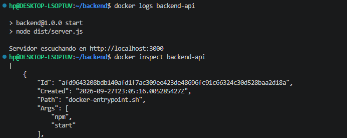

**¿Cuál es la diferencia entre el puerto del contenedor y el puerto publicado en el host?**

El puerto del contenedor es donde la aplicación escucha dentro de la red aislada del contenedor, y solo es visible dentro de Docker. El puerto publicado es el que Docker abre en la máquina host y redirige hacia el contenedor con `-p HOST:CONTENEDOR`. En `-p 3000:3000`, el primer número es el del host y el segundo el del contenedor. Pueden ser distintos, por ejemplo `-p 5000:3000` y entonces accederías desde localhost:5000, aunque la app este escuchando internamente en el 3000. 

---

## 7. `localhost` vs nombre del servicio Docker (Pregunta Parte 5)

**¿Por qué http://api:3000 funciona entre contenedores, mientras que http://localhost:3000 no representa correctamente al contenedor api?**

Cada contenedor tiene su **propio espacio de red** aislado, con su propia interfaz y su propio `localhost`. Por eso, `localhost` dentro de un contenedor siempre se refiere a **ese mismo contenedor**, no al host ni a los demás contenedores.

- Si Nginx usa `http://localhost:3000`, se busca a sí mismo, y en el contenedor de Nginx no hay nada escuchando en el puerto 3000.
- Si Nginx usa `http://api:3000`, el DNS interno de Docker Compose traduce `api` a la IP del contenedor de la API dentro de la red `backend`, y la petición llega correctamente.

Por la misma razón, posteriormente la API referencia a Redis con `REDIS_HOST=redis`, y no con `localhost`.

---

## 8. `ports` vs `expose` en Docker Compose (Pregunta Parte 7)

**Explique la diferencia entre ports y expose en Docker Compose.**

| | `ports` | `expose` |
|---|---|---|
| Qué hace | **Publica** el puerto del contenedor en el host (`"HOST:CONTENEDOR"`) | **Declara** el puerto solo para los contenedores de la misma red |
| Accesible desde el host / navegador | Sí | No |
| Accesible desde otros contenedores | Sí | Sí |
| Uso en este proyecto | `nginx`: `"8080:8080"` | `api`: `"3000"`, `redis`: `"6379"` |

En este proyecto, **Nginx usa `ports`** porque es la única entrada pública, mientras que **la API y Redis usan `expose`**. Así, los usuarios no pueden saltarse el proxy entrando por `localhost:3000`, y los servicios internos quedan protegidos.

Esto se ve en `docker compose ps`: `backend-api` muestra `3000/tcp` (sin `0.0.0.0`, es decir, no publicado), mientras que `nginx-proxy` muestra `0.0.0.0:8080->8080/tcp` (publicado en el host). En algunas versiones de Docker, `nginx-proxy` también muestra `80/tcp`, que viene del `EXPOSE 80` de la imagen oficial de Nginx; es solo informativo y no está publicado.

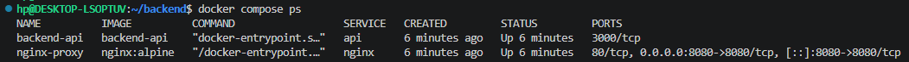

---

## 9. Evidencias de las pruebas

### 9.1 API ejecutándose en Docker (Parte 2)

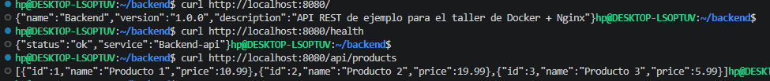

### 9.2 `curl http://localhost:8080/`

```json
{"name":"Backend","version":"1.0.0","description":"API REST de ejemplo para el taller de Docker + Nginx"}
```

### 9.3 `curl http://localhost:8080/health`

```json
{"status":"ok","service":"Backend-api"}
```

### 8.7 `docker compose ps`


### 8.8 Logs de Nginx y de la API

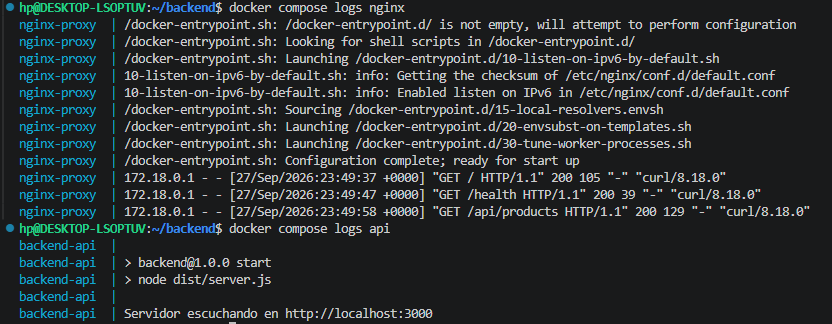

### 8.9 Reto adicional: comunicación con Redis por DNS (Parte 10)

```bash
docker compose ps
docker compose exec -it backend-api sh
ping -c 3 redis
```

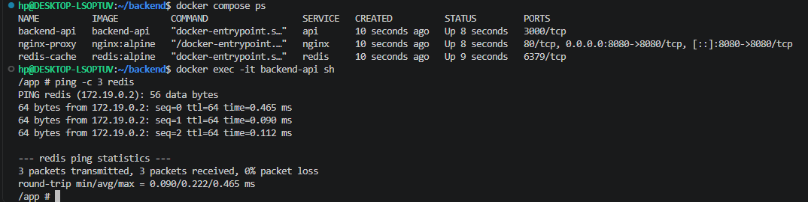

El contenedor `backend-api` alcanza a Redis usando únicamente el nombre `redis`, sin configurar IPs, gracias al DNS interno de Docker Compose. La variable `REDIS_HOST=redis` deja lista la configuración para cuando se implemente la lógica de caché, que se conectará a `redis:6379`. Redis usa `expose`, por lo que tampoco es accesible desde el host.

---

## 9. Troubleshooting: uso de `localhost` en Nginx

Se modificó temporalmente el `upstream` de `nginx/nginx.conf`:

```nginx
upstream api_backend {
    server localhost:3000;   # antes: server api:3000;
}
```

y se ejecutó:

```bash
docker compose down
docker compose up -d
curl http://localhost:8080/health
docker compose logs nginx
```

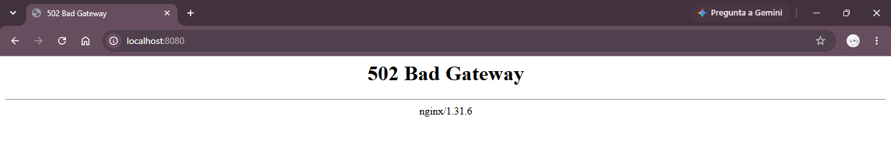

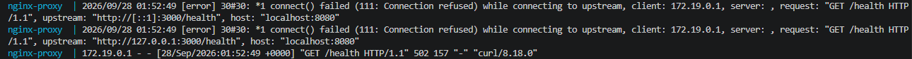

### 9.1 ¿Qué error se obtiene?

**`502 Bad Gateway`**. En los logs de Nginx aparece un mensaje como:

```
connect() failed (111: Connection refused) while connecting to upstream, upstream: "http://127.0.0.1:3000/health"
```

### 9.2 ¿Por qué ocurre?

Nginx intenta conectarse a `127.0.0.1:3000`, que es la interfaz local de **su propio contenedor**. En el contenedor de Nginx no hay ningún proceso escuchando en el puerto 3000, así que la conexión es rechazada y Nginx responde `502` porque no pudo comunicarse con el servidor de destino.

### 9.3 ¿Por qué `localhost` no representa al contenedor `api`?

Cada contenedor tiene su propio namespace de red, aislado de los demás. `localhost` siempre apunta al contenedor que hace la petición. La API corre en otro contenedor (`backend-api`), con otra IP dentro de la red `backend_backend`.

### 9.4 ¿Cómo se soluciona?

Volviendo a usar el nombre del servicio de Docker Compose:

```nginx
upstream api_backend {
    server api:3000;
}
```

y reiniciando Nginx con `docker compose restart nginx`. El DNS interno de Docker resuelve `api` a la IP del contenedor de la API y el proxy vuelve a funcionar.

### 9.5 ¿Qué comando se usa para verificar las redes Docker?

```bash
docker network ls                      # lista las redes
docker network inspect backend_backend # contenedores conectados y sus IPs
```

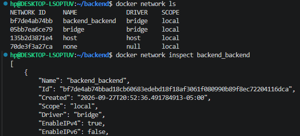

---

## 10. Conclusiones

- Docker permite empaquetar la API con todas sus dependencias y ejecutarla igual en cualquier máquina.
- Las variables de entorno separan la configuración (como el puerto) del código.
- Docker Compose simplifica la ejecución de varios servicios y crea automáticamente una red con DNS interno.
- Nginx como reverse proxy centraliza la entrada pública y oculta los servicios internos.
- Dentro de Docker, los contenedores deben comunicarse por **nombre de servicio**, nunca por `localhost`.

---

## 11. Anexo: evidencias del proceso de creación del proyecto
 
Capturas de los comandos utilizados, en el orden en que se ejecutaron.
 
### 11.1 Inicializar el proyecto de Node.js
 
```bash
npm init -y
```
 
Crea el archivo `package.json` con la configuración base del proyecto.
 
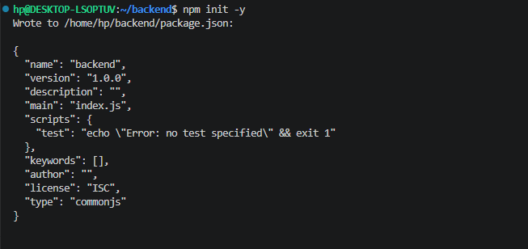
 
### 11.2 Instalar dependencias
 
```bash
npm install express
npm install -D typescript tsx @types/express @types/node
```
 
Se instala Express como dependencia de producción, y TypeScript, `tsx` y los tipos de Express y Node como dependencias de desarrollo.
 
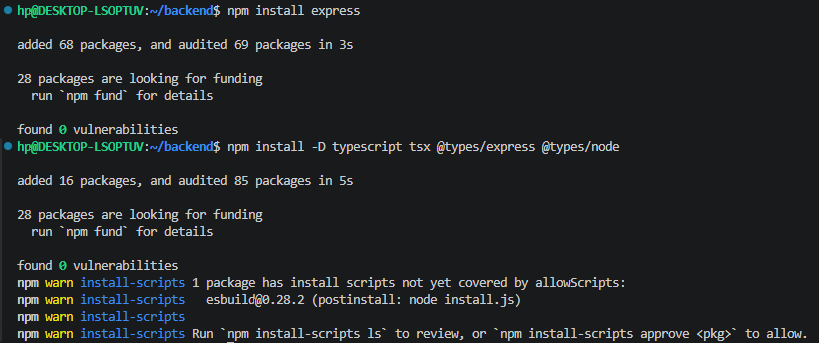
 
### 11.3 Crear la configuración de TypeScript
 
```bash
npx tsc --init
```
 
Genera el archivo `tsconfig.json`, que luego se ajustó para compilar `src/` en `dist/`.
 
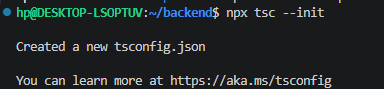
 
### 11.4 Ejecutar la API localmente, sin Docker
 
```bash
PORT=3000 npm run dev
```
 
La API arranca leyendo el puerto desde la variable de entorno `PORT`.
 
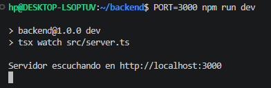
 
### 11.5 Construir la imagen Docker
 
```bash
docker build -t backend-api .
```
 
Se ven los 6 pasos del `Dockerfile`: imagen base `node:20-alpine`, `WORKDIR`, copia de `package*.json`, `npm install`, copia del código y compilación con `npm run build`.
 
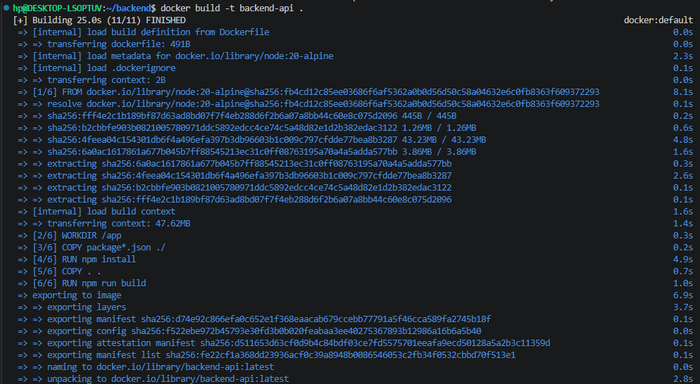
 
### 11.6 Verificar la imagen creada
 
```bash
docker images
```
 
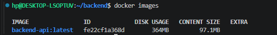
 
### 11.7 Ejecutar el contenedor y verificar que está corriendo
 
```bash
docker run -d \
  --name backend-api \
  -p 3000:3000 \
  -e PORT=3000 \
  backend-api
 
docker ps
```
 
El contenedor queda en estado `Up` y publica el puerto `0.0.0.0:3000->3000/tcp`.
 
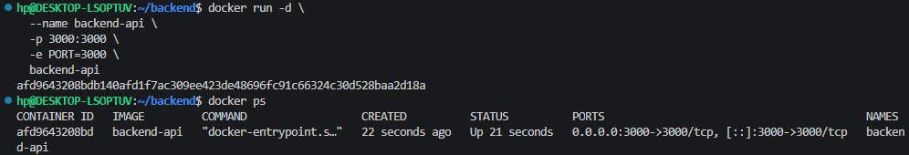
 
### 11.8 Analizar el contenedor
 
```bash
docker logs backend-api
docker inspect backend-api
```
 
Los logs muestran que el servidor arrancó con `node dist/server.js`, y `inspect` muestra el ID del contenedor y el comando de inicio (`npm start`).
 

 
### 11.9 Levantar los servicios con Docker Compose
 
```bash
docker compose up -d --build
docker compose ps
```
 
Construye la imagen de la API y levanta los servicios definidos en `compose.yaml`. La captura es un ejemplo de su uso: este comando se ejecutó varias veces durante el taller, junto con otros comandos de Docker (`docker compose down`, `restart`, `logs`, `exec`, `docker network inspect`), a medida que se completaba cada parte. La lista completa está en la sección 5.
 
En la construcción aparecen pasos `CACHED` (`WORKDIR`, `COPY package*.json`, `npm install`): Docker reutilizó esas capas porque las dependencias no cambiaron, lo que demuestra la ventaja de copiar primero los archivos de dependencias en el `Dockerfile`.
 
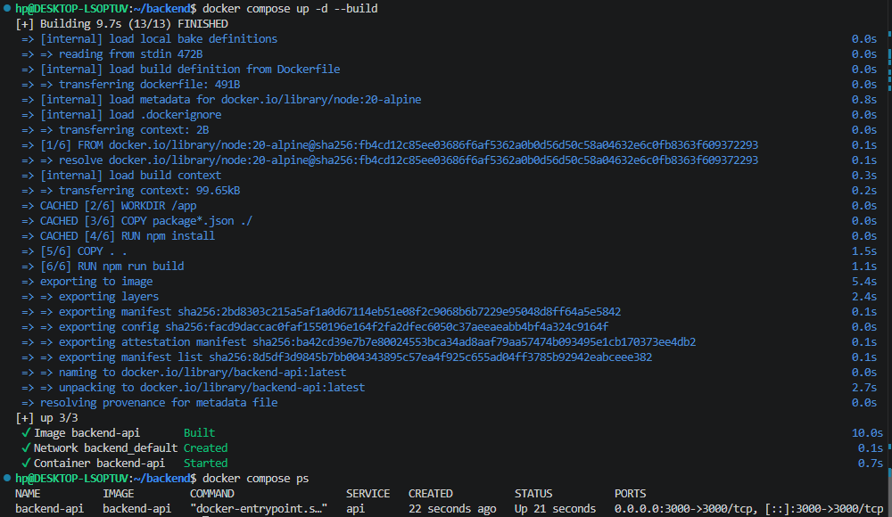